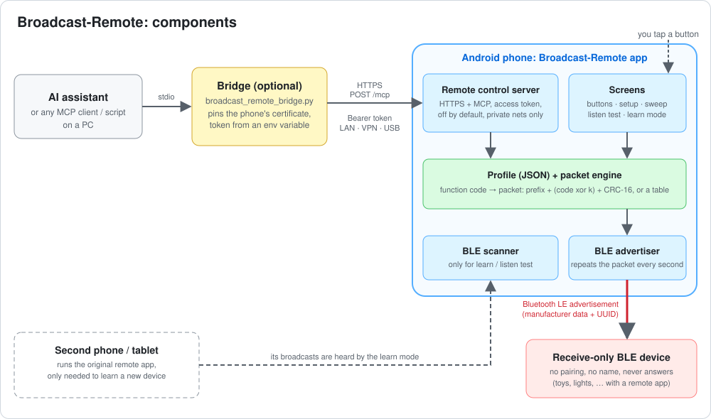
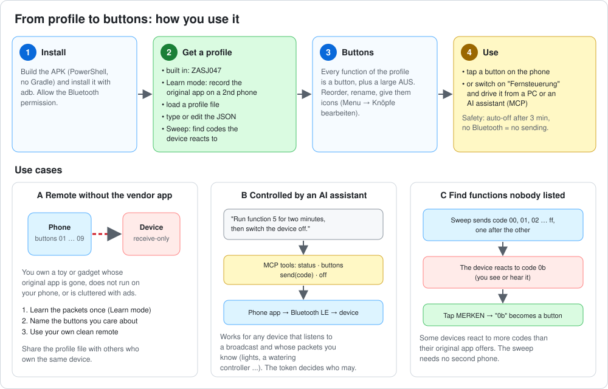
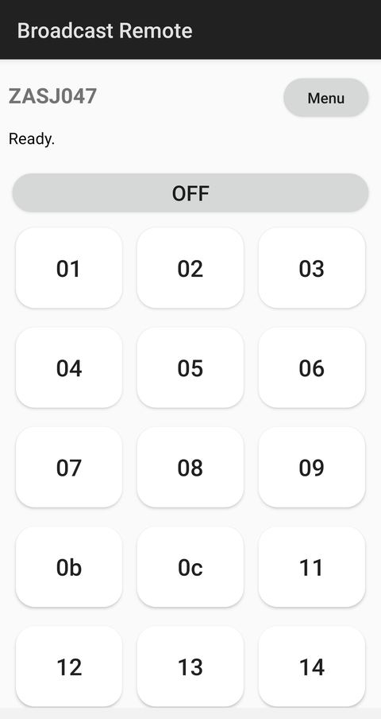
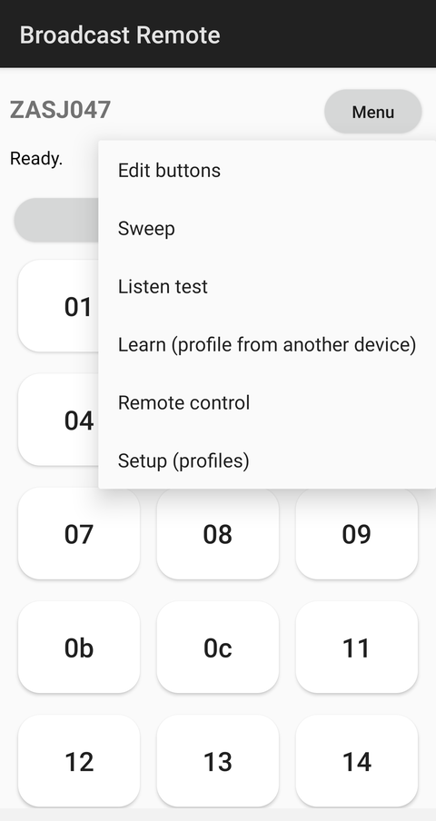
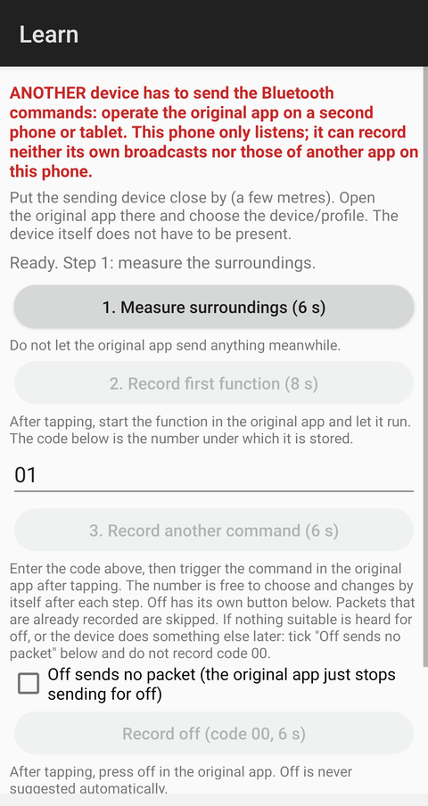
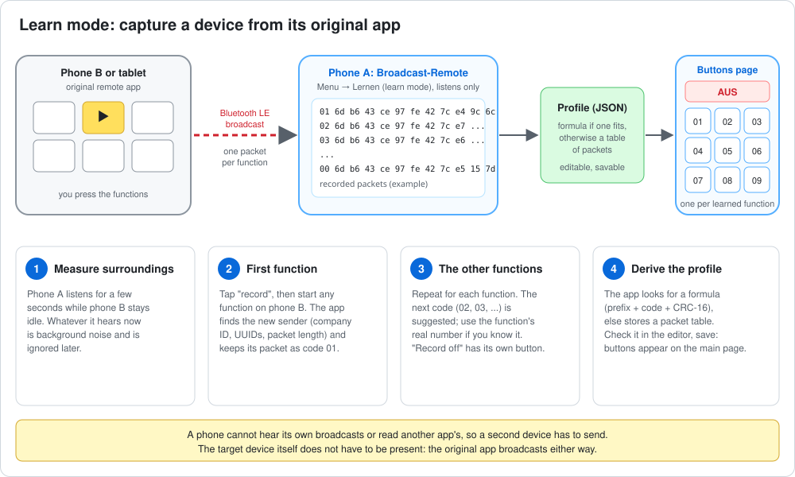

# Broadcast-Remote

An Android app that remote-controls **receive-only Bluetooth LE devices**: gadgets that never advertise a name,
never accept a connection and simply listen for a broadcast packet from their original remote app. The phone sends
those packets, driven by a **device profile** (a small JSON file). Optionally the app can be operated from a PC or
by an AI assistant through an [MCP](https://modelcontextprotocol.io) interface.

> Status: working with one device (ZASJ047, from the LS-Remote app family). Another device is a matter of adding a
> profile, see [docs/CAPTURE_GUIDE.md](docs/CAPTURE_GUIDE.md).

## How it works

Some toys and gadgets are not paired and cannot be connected to. Their remote app only **broadcasts** a short
Bluetooth LE advertisement ("manufacturer data": a company ID plus a few payload bytes); the device picks it up
and does what the payload says. Nothing comes back. If you know the packet, any phone can play the remote.



- The **app** is the remote. Buttons send a *function code* (one byte); the profile turns it into the packet.
- A **profile** says how to send (company ID, service UUIDs, repeat rate) and how to compute the packet for a code
  (a formula such as `prefix + (code xor k) + CRC-16`, or a table of complete packets).
- The **bridge** ([pc/broadcast_remote_bridge.py](pc/broadcast_remote_bridge.py)) is optional and only needed to
  let an AI assistant or a script on a PC use the app; see [docs/MCP.md](docs/MCP.md).



## Requirements

- Android 8.0 or newer with Bluetooth LE **advertising** support (most phones since about 2015).
- To build: Android SDK (build-tools 35, platform 35), a JDK, PowerShell. No Gradle.
- For the PC bridge: Python 3 (standard library only).
- Permissions: *Nearby devices* (Bluetooth) on Android 12+; for the Sweep/Listen/Learn screens on Android 10-11 also
  *Location* permission and location services switched on (Android requires this for Bluetooth scans).

## Quick start

```powershell
cd android
powershell -NoProfile -ExecutionPolicy Bypass -File build.ps1   # -> android/broadcast-remote.apk
adb install -r broadcast-remote.apk
```

`build.ps1` creates a debug keystore on first run (`android/debug.keystore`, not committed). Open the app, allow
the Bluetooth permission, and you see the buttons of the built-in **ZASJ047** profile. Without a matching device
nothing happens, which is the point of the next sections: put your own device in via a profile.

## The screens

| Screen (menu entry) | What it does |
|---|---|
| **Main page** | One button per function of the active profile, a large **OFF** button and a status line. If Bluetooth is off, buttons and remote control are locked and a red message says so. |
| *Edit buttons* | Reorder, rename, choose an emoji icon, add or remove buttons. |
| *Sweep* | Sends every code in a range one after the other. Tap **REMEMBER** when the device reacts: the code becomes a button of the active profile. |
| *Listen test* | Sends a code and scans at the same time to see whether the device sends *anything* back. For the supported device: nothing, it only receives. |
| *Learn (profile from another device)* | Builds a profile from another phone running the original app, see below. |
| *Remote control* | Switches the HTTPS/MCP server on (off by default); shows address, access token and certificate. See [docs/MCP.md](docs/MCP.md). |
| *Setup (profiles)* | Choose the active profile; edit it as JSON (with a packet preview), copy, delete, load from or save to a file, or enter a new one. |

<p>
  
  
  
</p>

### Button names

A button is identified by its **code** (one byte, shown as hex, for example `01`, `0b`). The label is optional and
only changes what is displayed; if a profile defines no label, the button shows the hex code. Over MCP the code is
the address and the label is returned as extra information. The profile does not know what a function does (the
device never says), so label the buttons yourself.

### Safety

- No Bluetooth, no sending. Remote control has to be switched on explicitly each time.
- After `autoOffSeconds` without a new command (default 3 minutes) the app switches the device off by itself.
  When you leave the app without the remote control running, it sends *off*.

## Learn mode: capture a device from the original app



A phone **cannot hear its own broadcasts**, nor read what another app on it sends, so you need two devices: phone A
runs Broadcast-Remote in learn mode, phone B (or a tablet) runs the **original** remote app. The device itself does
not have to be present: the original app broadcasts either way.

1. Put the two devices a few metres apart. On B open the original app and choose the device.
2. On A: *Menu → Learn*. Step 1 measures the surroundings for a few seconds; leave B idle.
3. Step 2: press the first function on B while A listens, then step 3 for each further function (the code number is
   suggested and can be changed). The **Record off** button records the off command; tick
   *Off sends no packet* if the original app sends nothing for off.
4. *Derive profile* tries a formula; if none fits it stores a table of packets. Check the result in
   the editor and save it.

The code numbers you give are your own labels. A formula is only found if they equal the function numbers the
original app uses, which is why the app suggests 01, 02, 03, ... in order.

## Adding a device with a PC instead

A bugreport of the phone running the original app contains its Bluetooth advertisements (no root needed):

```
adb bugreport bugreport.zip
python tools/hci_adv_extract.py bugreport.zip              # what did the original app send?
python tools/profile_tool.py learn capture.txt --name X    # derive a profile (formula if one fits, else a table)
python tools/profile_tool.py check profile.json capture.txt
```

Details: [docs/CAPTURE_GUIDE.md](docs/CAPTURE_GUIDE.md). Profile format: [docs/PROFILE_FORMAT.md](docs/PROFILE_FORMAT.md).
Tests: `python -I -m unittest discover -s tests` and `tests/PayloadCheck.java` (checks the Java engine against the
same captured packets).

## Control from a PC or an AI assistant

Switch on *Remote control*, copy the token and the certificate, set `BROADCAST_REMOTE_TOKEN` and
`BROADCAST_REMOTE_URL`, and register the bridge as a stdio MCP server ([.mcp.json.example](.mcp.json.example)).
The assistant gets four tools: `status`, `buttons`, `send(code)` and `off`. The bridge exists because many MCP
clients cannot talk to a self-signed certificate; it pins the phone's certificate itself and takes the token from
the environment, so neither the system trust store nor a config file is touched. Full description, security notes
and troubleshooting: [docs/MCP.md](docs/MCP.md).

## Limitations

- Receive-only devices send no feedback; neither the app nor an assistant can tell whether the device reacted.
- Devices that the original app *connects* to (GATT) are out of scope, as are devices that need pairing.
- Some devices use a rolling code or a per-device ID. A fixed table may then work only for one device.
- Android limits advertising: one packet at a time here, and the interval is up to the phone.

## Legal and safety

Use it only with devices you own. This project is not affiliated with any device or app vendor and contains no code
or files from vendor apps: the protocol notes were obtained by observing the Bluetooth packets such an app sends,
for interoperability. Treat the access token like a password.

## License

MIT, see [LICENSE](LICENSE).
